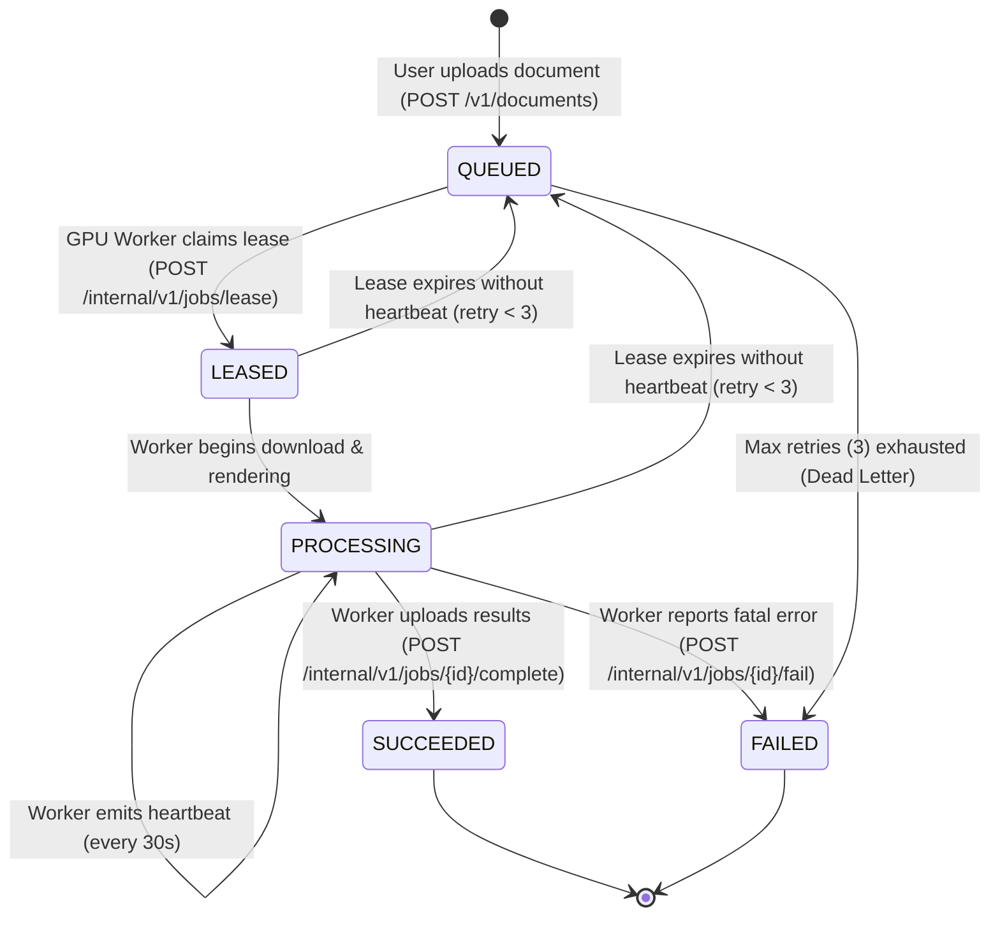

# Architecture Specification: Unlimited OCR Cloud

## 1. System Topology Overview

```
[Clients: Web Dashboard / Python SDK / TypeScript SDK / cURL / n8n / MCP]
                               |
                               | HTTPS / TLS 1.3
                               v
+---------------------------------------------------------------------------------+
| LAYER A: ORACLE CLOUD INFRASTRUCTURE (Always Free ARM64)                        |
|                                                                                 |
|   +-------------------------------------------------------------------------+   |
|   | Caddy Edge Reverse Proxy (Port 80/443)                                  |   |
|   | - Automated Let's Encrypt TLS & HSTS                                    |   |
|   | - HTTP-to-HTTPS redirect                                                |   |
|   | - Edge Rate Limiting & Request ID injection (`X-Request-ID`)            |   |
|   +-------------------------------------------------------------------------+   |
|                                        |                                        |
|   +------------------------------------+------------------------------------+   |
|   | FastAPI Control Plane (Uvicorn ASGI on ARM64)                           |   |
|   |                                                                         |   |
|   |   [Auth & Identity Layer]                                               |   |
|   |   - Multi-tenant isolation (tenant_id context)                          |   |
|   |   - Argon2id salted API key verification                                |   |
|   |   - Bearer JWT session authentication for web users                     |   |
|   |                                                                         |   |
|   |   [Document Ingestion & Security Guard]                                 |   |
|   |   - Magic byte validation (`%PDF-`, PNG, JPEG)                          |   |
|   |   - Page count & size limits (max 50MB, max 200 pages)                  |   |
|   |   - AES-256-GCM encryption at rest                                      |   |
|   |                                                                         |   |
|   |   [Job Manager & Leased Queue Engine]                                   |   |
|   |   - Job lifecycle state machine (QUEUED -> LEASED -> PROCESSING ...)    |   |
|   |   - Lease timeout monitor & automatic dead-worker recovery              |   |
|   |   - Monthly quota accounting & concurrency limits                       |   |
|   |                                                                         |   |
|   |   [Webhook Dispatch Service]                                            |   |
|   |   - SSRF-protected DNS resolver (blocks private/metadata IPs)           |   |
|   |   - HMAC-SHA256 signature generator                                     |   |
|   |   - Exponential backoff delivery loop                                   |   |
|   +-------------------------------------------------------------------------+   |
|           |                                                      |              |
|   +-------+-------+                                      +-------+-------+      |
|   | PostgreSQL 16 | (Persistent Tenant, Jobs,            |    Redis 7    |      |
|   |    ARM64      |  Results, Keys, Audit)               |    ARM64      |      |
|   +---------------+                                      +---------------+      |
+---------------------------------------------------------------------------------+
                                         ^
                                         | Outbound HTTPS Polling & Result Upload
                                         | (No public ports exposed on worker)
+----------------------------------------+----------------------------------------+
| LAYER B: GPU INFERENCE WORKER (RunPod / Modal / Vast.ai / Local NVIDIA CUDA)    |
|                                                                                 |
|   +-------------------------------------------------------------------------+   |
|   | Worker Daemon (Python 3.11+, asyncio)                                   |   |
|   | - Polling loop: queries control plane for next leased job               |   |
|   | - Heartbeat daemon: renews lease every 30s while running                |   |
|   | - Short-lived HMAC presigned URL downloader                             |   |
|   |                                                                         |   |
|   | [Dual-Route Processing Engine]                                          |   |
|   | - Route A: PyMuPDF vector text layer extractor (digital pages)          |   |
|   | - Route B: PyMuPDF bounded rasterizer -> Unlimited-OCR-2 inference      |   |
|   |                                                                         |   |
|   | [Deterministic Post-Processor]                                          |   |
|   | - Markdown layout parser -> Typed Block hierarchy                       |   |
|   | - Normalizer to versioned `schema_version: "1.0"` JSON                  |   |
|   | - Generates Markdown and plain text representations                     |   |
|   |                                                                         |   |
|   | [Result Uploader & Finalizer]                                           |   |
|   | - Uploads encrypted results payload to control plane                    |   |
|   | - Marks job completed or reports structured error code                  |   |
|   +-------------------------------------------------------------------------+   |
+---------------------------------------------------------------------------------+
```

---

## 2. Resource Allocation on Oracle Ampere A1 (Always Free)

Oracle Cloud Infrastructure provides up to 4 OCPUs and 24 GB RAM in the Always Free tier. To leave room for staging or parallel workloads, Unlimited OCR Cloud is budgeted strictly within:
- **Max Allocation**: 2 OCPUs (4 ARM64 vCPUs) and 12 GB RAM.
- **Operating System**: Ubuntu 24.04 LTS (ARM64).

### Container Resource Budget
| Component | Base Image | CPU Limit | RAM Limit | Justification |
|---|---|---|---|---|
| **Caddy** | `caddy:2.8-alpine` | 0.2 OCPU | 128 MB | Low memory footprint, fast HTTP/3 and TLS 1.3 |
| **FastAPI Backend** | `python:3.11-slim` | 1.0 OCPU | 1024 MB | 4 Uvicorn workers handling API and validation |
| **PostgreSQL 16** | `postgres:16-alpine` | 0.5 OCPU | 2048 MB | Shared buffers: 512MB, work_mem: 16MB |
| **Redis 7** | `redis:7.2-alpine` | 0.2 OCPU | 512 MB | In-memory token bucket, lease keys, maxmemory-policy volatile-lru |
| **Host Reserve** | Ubuntu 24.04 | 0.1 OCPU | ~8 GB | OS file page caching, disk I/O buffers |

> [!CRITICAL]
> **Zero GPU Models on Oracle**: Running the 3.3B parameter Unlimited-OCR-2 model on Oracle ARM64 CPU would exhaust CPU and RAM instantly, causing kernel OOM kills. The model runs exclusively on Layer B.

---

## 3. Worker Lease & Job State Machine



### Lease Expiration and Recovery Rules
1. When a worker claims a job, a lease record is created with `expires_at = now() + 300 seconds`.
2. While processing, the worker daemon calls `POST /internal/v1/jobs/{id}/heartbeat` every 30 seconds, extending `expires_at` by 120 seconds.
3. A background task in FastAPI (`lease_monitor`) checks every 15 seconds for jobs in `LEASED` or `PROCESSING` state where `expires_at < now()`.
4. If a worker crashes or loses network connectivity:
   - The job's `retry_count` is incremented.
   - If `retry_count <= 3`, state reverts to `QUEUED` with an exponential delay.
   - If `retry_count > 3`, state transitions to `FAILED` with error code `WORKER_LEASE_TIMEOUT`.

---

## 4. Dual-Route OCR Pipeline Design

To achieve optimal throughput, zero compute waste, and maximum accuracy, the worker employs a dual-route architecture:

```
[Document Ingested: PDF / Image]
               |
               v
   [PyMuPDF Document Inspector]
               |
    +----------+----------+
    |                     |
[Vector Text Density]   [Scan / Degraded / Low Text]
    |                     |
    v                     v
(Route A: Native)     (Route B: AI OCR)
PyMuPDF Text Extract  Render to 150-200 DPI PNG
Layout & Bounding     Unlimited-OCR-2 (SR-SWA)
Table Grid Analysis   Raw Markdown Output
    |                     |
    +----------+----------+
               |
               v
 [Deterministic Post-Processor]
 - Normalizes headings, lists, tables, formulas
 - Reconstructs reading order
 - Emits `schema_version: "1.0"` JSON, Markdown, and text
```

### Route Selection Heuristic
For each page in a document:
- Calculate text coverage ratio: `text_character_count / page_area`.
- If vector character count > 200 and image coverage < 25%, route to **Route A (Native Vector)**.
- If vector text count < 50 or image coverage > 75%, route to **Route B (AI OCR)**.
- Hybrid mode allows page-by-page routing, saving up to 80% of GPU compute on hybrid digital/scanned filings.

---

## 5. Storage & Cryptography Architecture

1. **Storage Layout**:
   ```
   /storage/vault/
   ├── {tenant_id}/
   │   ├── docs/
   │   │   └── {document_id}.enc      <-- Original encrypted PDF
   │   └── results/
   │       ├── {job_id}.json.enc      <-- Structured JSON result
   │       ├── {job_id}.md.enc        <-- Markdown result
   │       └── {job_id}.txt.enc       <-- Plain text result
   ```
2. **Encryption Key Hierarchy**:
   - Master Storage Key: 256-bit AES key supplied via environment variable `STORAGE_ENCRYPTION_KEY`.
   - Per-Document IV/Nonce: 96-bit random nonce generated for every file write using `secrets.token_bytes(12)`.
   - Algorithm: AES-256-GCM with authenticated tag verification on read.
3. **Zero-Knowledge Worker Access**:
   - Worker receives a temporary signed token (`HMAC-SHA256`) containing `job_id`, `document_id`, and `expires_at`.
   - Worker downloads document via authenticated stream and decrypts in worker memory.
   - Encrypted data at rest is never exposed unauthenticated.
